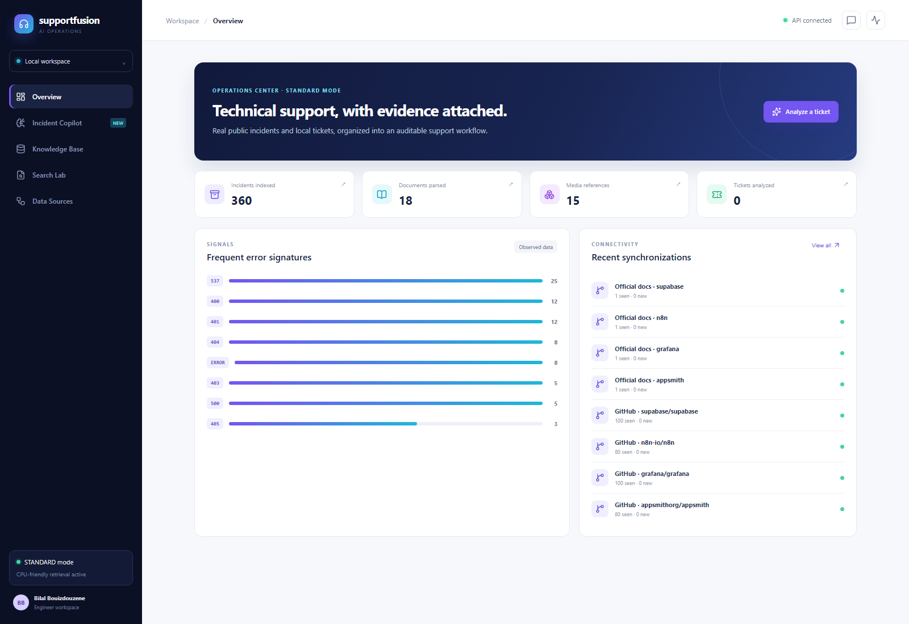
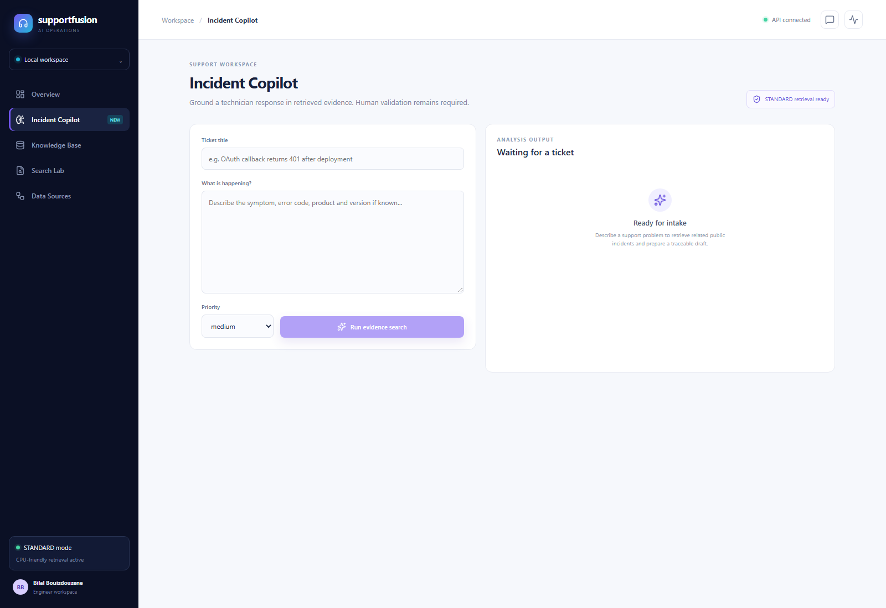
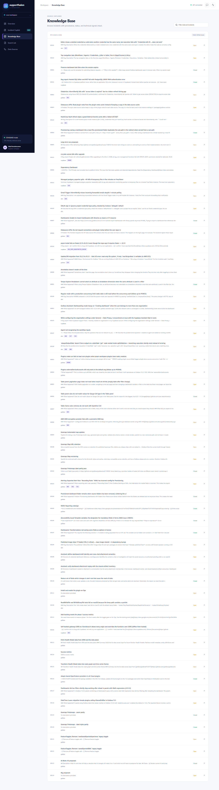
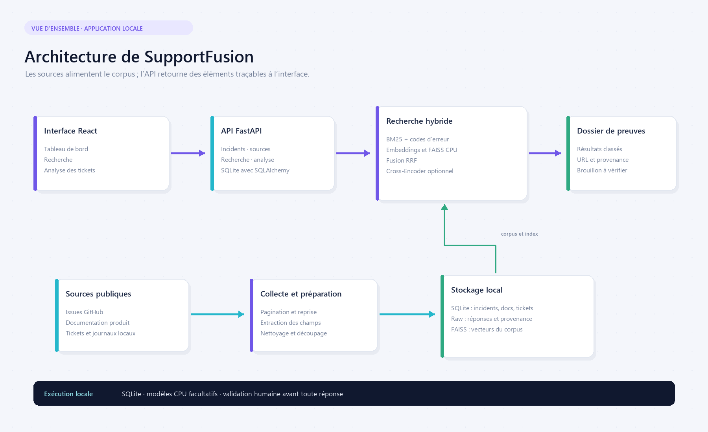
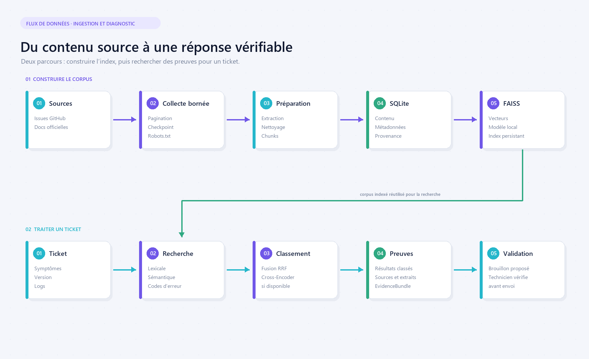

# SupportFusion AI

**Un poste de travail local pour diagnostiquer les incidents techniques à partir de preuves consultables.**

SupportFusion rassemble les tickets, les incidents GitHub et la documentation produit. La recherche hybride fait remonter les éléments proches d’un problème et prépare une réponse que le technicien peut vérifier avant de l’envoyer.

[](https://www.python.org/)
[](https://fastapi.tiangolo.com/)
[](https://www.typescriptlang.org/)
[](LICENSE)

## Captures d’écran

### Tableau de bord



### Incident Copilot



### Base de connaissances



## Architecture

Les collecteurs alimentent une base SQLite avec les URL sources et les métadonnées de provenance. À la recherche, l’API combine les résultats lexicaux et sémantiques, puis renvoie les éléments retenus avec leur source.



## Parcours d’un incident



## Fonctions

- Collecte paginée des issues GitHub, avec reprise de synchronisation et exclusion des pull requests.
- Import borné de pages de documentation officielles, avec dédoublonnage et provenance.
- Recherche lexicale et détection de codes d’erreur, complétées en mode STANDARD par embeddings FAISS, fusion RRF et reclassement Cross-Encoder.
- Analyse d’un ticket avec éléments justificatifs, informations manquantes et brouillon de réponse.
- Interface de consultation des incidents, sources, journaux et résultats de recherche.
- Fonctionnement local avec FastAPI, SQLite et une interface React/TypeScript.

Le système présente des correspondances à vérifier. Il ne confirme pas seul une résolution et n’envoie pas de réponse au client.

## Technologies

| Partie | Outils |
| --- | --- |
| API | Python, FastAPI, SQLAlchemy, Alembic |
| Stockage | SQLite |
| Interface | React, TypeScript, Vite |
| Recherche standard | Sentence-Transformers, FAISS CPU, RRF, Cross-Encoder |
| Sources | GitHub Issues et documentation officielle |

## Installation sous Windows

Prérequis : Python 3.11 ou plus récent et Node.js 20 ou plus récent.

```powershell
Set-ExecutionPolicy -Scope Process Bypass
.\setup_local.ps1
```

Lancer l’API et l’interface dans deux fenêtres PowerShell :

```powershell
.\start_backend.ps1
```

```powershell
.\start_frontend.ps1
```

Ouvrir ensuite [http://localhost:5173](http://localhost:5173). Le script d’installation prépare `.env` à partir de `.env.example`. Ajouter un `GITHUB_TOKEN` dans `.env` si la limite d’accès anonyme de l’API GitHub est insuffisante.

## Activer la recherche dense

Le mode LIGHT fonctionne avec les dépendances de base. Pour activer le moteur dense local :

```powershell
$pythonExe = ".\.venv\Scripts\python.exe"
if (-not (Test-Path $pythonExe)) {
  $pythonExe = ".\.venv-supportfusion\Scripts\python.exe"
}
& $pythonExe -m pip install -r requirements-standard.txt
& $pythonExe scripts\index_knowledge_base.py --dense --force
```

Le premier chargement des modèles Sentence-Transformers peut les récupérer depuis Hugging Face si leur cache local est vide. La recherche retombe sur le classement lexical si les dépendances ou les modèles ne sont pas disponibles.

Pour préparer explicitement les deux modèles avant une recherche, exécuter :

```powershell
.\scripts\download_models.ps1
```

## Collecter des incidents

```powershell
$pythonExe = ".\.venv\Scripts\python.exe"
if (-not (Test-Path $pythonExe)) {
  $pythonExe = ".\.venv-supportfusion\Scripts\python.exe"
}
& $pythonExe scripts\collect_github.py --repo appsmithorg/appsmith --limit 80
& $pythonExe scripts\collect_docs.py --product appsmith --limit 5
```

Les collecteurs prennent aussi en charge `grafana/grafana`, `n8n-io/n8n` et `supabase/supabase`. La base locale et les index sont exclus de Git ; chaque clone crée ses propres données en lançant les collecteurs.

## État du corpus de démonstration

La base locale vérifiée le 3 novembre 2026 contient 360 incidents GitHub, 18 pages de documentation et 42 relations incident–pull request. Elle sert aux captures d’écran de ce dépôt. Les données brutes, la base SQLite et l’index FAISS ne sont pas publiés.

## Évaluation

Le script `scripts/evaluate_retrieval.py` compare les modes à partir d’annotations JSONL révisées manuellement. Il calcule MRR, nDCG@5, Recall@K, Precision@K et la latence p95. Aucun score n’est annoncé tant qu’un jeu d’évaluation annoté n’a pas été constitué.

## API

Une fois l’API démarrée, la documentation interactive est disponible à [http://127.0.0.1:8000/docs](http://127.0.0.1:8000/docs). Les principales routes sont :

| Route | Usage |
| --- | --- |
| `GET /api/health` | État de l’API et de la base |
| `GET /api/dashboard` | Compteurs et synchronisations récentes |
| `GET /api/incidents` | Liste filtrable des incidents |
| `GET /api/search?q=...` | Recherche avec méthode et provenance |
| `GET /api/sources` | Sources et historique des collectes |
| `POST /api/tickets/analyze` | Analyse d’un ticket et constitution du dossier de preuves |

## Structure du dépôt

```text
backend/       API, modèles de données, collecte et recherche
frontend/      interface React et TypeScript
ml/            composants de recherche et métriques
scripts/       collecte, indexation et évaluation
docs/images/   schémas et captures affichés dans ce README
data/          données locales ignorées par Git
```

## Licence

Ce projet est distribué sous licence [MIT](LICENSE). Les données collectées restent soumises aux licences et conditions d’utilisation de leurs sources respectives.

## Auteur

Bilal Bouizdouzene — [portfolio](https://bilalbouizdouzene.github.io)
